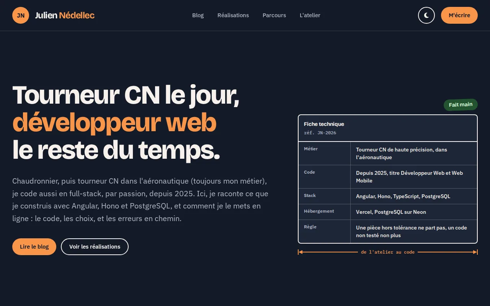
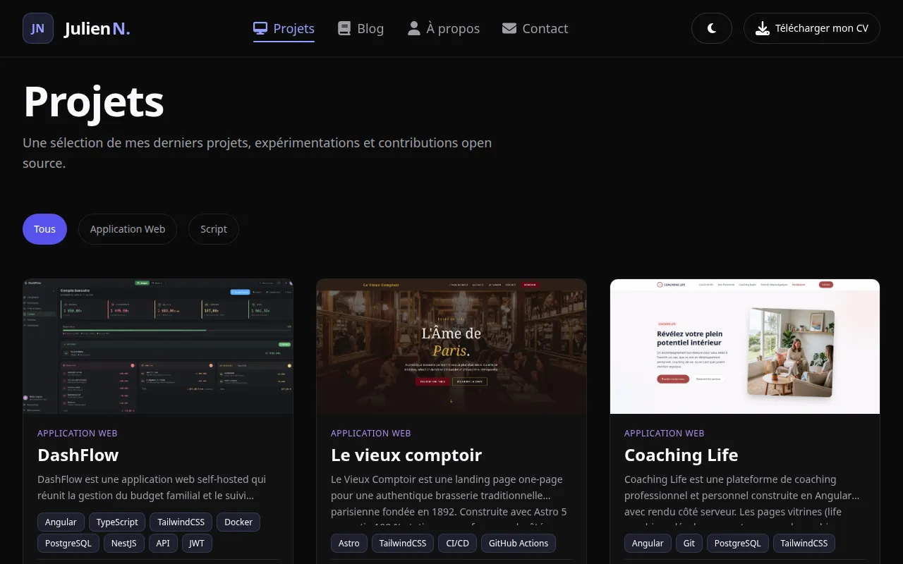
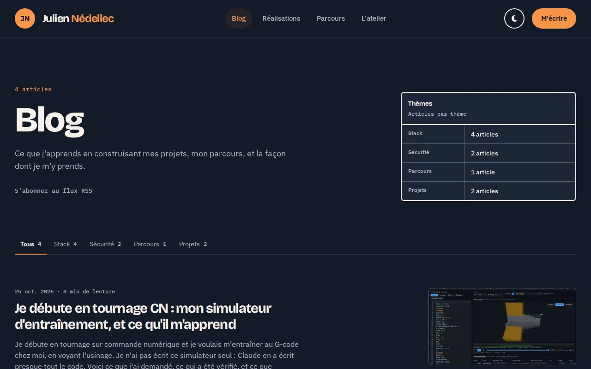
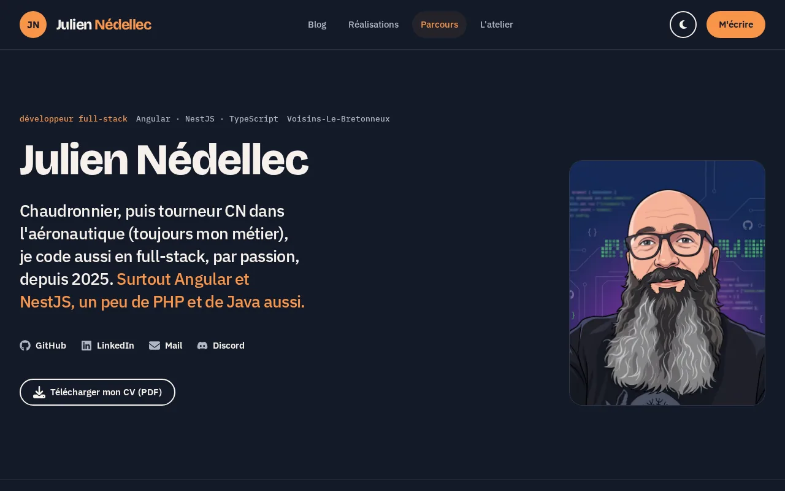
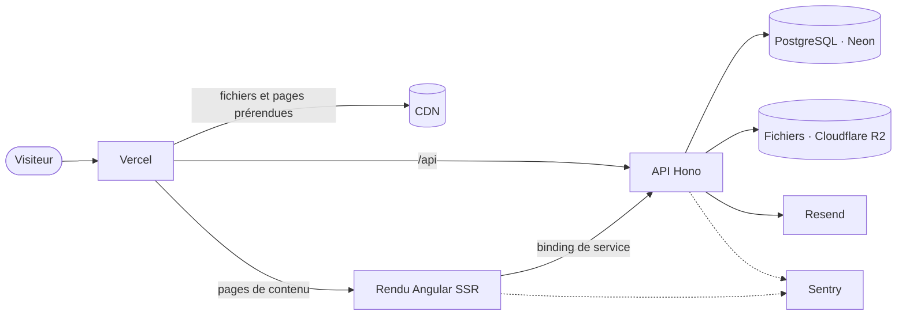

<div align="center">

# nedellec-julien.fr

**Portfolio full-stack de Julien Nédellec : vitrine, blog, back-office et mesure d'audience maison.**

Angular · Hono · PostgreSQL · Vercel · sans cookie ni tracker tiers

[](https://github.com/j-ned/j-ned-app/actions/workflows/web-ci.yml)
[](https://github.com/j-ned/j-ned-app/actions/workflows/api-ci.yml)
[](https://github.com/j-ned/j-ned-app/actions/workflows/web-a11y.yml)
[](apps/web/LICENSE)

[**Voir le site**](https://nedellec-julien.fr) · [Architecture](#architecture) · [Démarrer en local](#démarrer-en-local) · [Qualité](#qualité-et-ci)

</div>

<p align="center">
  
  
  
  
</p>

## En bref

Un portfolio construit et exploité comme un produit : le contenu s'édite depuis un back-office sans
redéploiement, les pages sont rendues côté serveur pour le référencement, et la fréquentation est
mesurée sans cookie, sans bandeau de consentement et sans envoyer de données à un tiers.

- **Contenu vivant** : une modification dans l'admin est visible au rechargement suivant, sans rebuild.
- **Rapide et trouvable** : rendu serveur des pages de contenu, prérendu des pages statiques, données
  structurées, images AVIF et cache immuable des fichiers empreintés.
- **Respectueux de la vie privée** : mesure d'audience maison, aucune adresse IP stockée.
- **Vérifié en continu** : tests unitaires et d'intégration, suite de parité HTTP de l'API, audit
  d'accessibilité WCAG AA en navigateur réel.

## Fonctionnalités

| Site public                                                                                               | Back-office (`/admin`)                                                      |
| --------------------------------------------------------------------------------------------------------- | --------------------------------------------------------------------------- |
| Accueil, à propos, projets filtrables avec fiches détaillées (choix techniques, décisions d'architecture) | Projets : édition, ordre, mise en avant, galerie, images converties en AVIF |
| Blog en Markdown assaini, tags, commentaires Giscus, « j'aime », flux RSS                                 | Blog : brouillon et publication, couverture, aperçu en direct               |
| Atelier : guide de plaquettes de tournage et décodeur de codes ISO                                        | Profil, CV, guide de l'atelier                                              |
| Formulaire de contact protégé (champ piège, quota par visiteur)                                           | Messages reçus                                                              |
| Téléchargement du CV, vraie page 404, `sitemap.xml`, `security.txt`                                       | Audience : visites, pages, provenances, appareils, pays, export CSV         |
| Thèmes clair et sombre, transitions de vue                                                                | Sécurité du compte : mot de passe, 2FA TOTP avec codes de secours           |

## Architecture



Le site et l'API sont deux services d'un même projet Vercel, servis par la même origine : ni CORS,
ni cookie partagé entre sous-domaines. Un merge sur `master` les déploie ensemble.

| Dossier                                      | Rôle                                                                          | Documentation                           |
| -------------------------------------------- | ----------------------------------------------------------------------------- | --------------------------------------- |
| [`apps/web`](apps/web)                       | Site Angular : zoneless, signals, rendu à la requête et prérendu, back-office | [README](apps/web/README.md)            |
| [`apps/api`](apps/api)                       | API Hono : auth JWT et 2FA, contenu, stockage, mesure d'audience, Drizzle     | [README](apps/api/README.md)            |
| [`packages/api-parity`](packages/api-parity) | Suite HTTP boîte noire : le contrat que l'API tient                           | [README](packages/api-parity/README.md) |

Le front suit une clean architecture en trois couches par feature (`domain` en TypeScript pur,
`infra` pour le HTTP, `application` et `pages` pour l'interface). Les décisions structurantes sont
consignées en ADR dans [`apps/web/docs/adr`](apps/web/docs/adr).

## Points techniques

**Rendu.** Les pages de contenu (accueil, projets, blog, atelier) sont rendues à chaque requête et
mises en cache par le CDN, avec repli sur la dernière copie si l'API tombe. Les pages légales sont
prérendues au build ; l'admin est rendu côté client. Les sections sous la ligne de flottaison
s'hydratent à la demande.

**Sécurité.**

- CSP sans `'unsafe-inline'` : scripts et styles inline hachés page par page, y compris au rendu serveur.
- Session dans un cookie `__Host-` httpOnly, révocable, avec 2FA TOTP.
- Toute écriture venue d'un autre site est refusée.
- Quotas par visiteur, Markdown assaini avant affichage, entrées validées par des schémas stricts.

**Vie privée.** La mesure d'audience ne pose aucun cookie. Une visite est reconnue par une empreinte
qui change chaque jour et ne permet pas de retrouver l'adresse IP, qui n'est jamais stockée. Le pays
vient de l'en-tête posé par l'hébergeur. Les robots, l'administrateur et les appareils exclus ne
sont pas comptés, et les événements bruts sont purgés au bout de 30 jours.

## Stack

|               |                                                                                                                            |
| ------------- | -------------------------------------------------------------------------------------------------------------------------- |
| **Front**     | Angular (zoneless, signals, Signal Forms, `@defer`), Tailwind CSS en CSS-first, Chart.js, marked + DOMPurify, highlight.js |
| **API**       | Hono, Drizzle ORM, PostgreSQL, zod, argon2, otplib, sharp, pino                                                            |
| **Services**  | Vercel, Neon, Cloudflare R2, Resend, Sentry                                                                                |
| **Outillage** | pnpm workspaces, TypeScript strict, Vitest, Jest, Playwright + axe, ESLint, Prettier, Husky                                |

## Démarrer en local

Prérequis : Node (version dans [`.nvmrc`](.nvmrc)), pnpm (via Corepack), et Podman ou Docker pour la
base PostgreSQL de développement.

```bash
pnpm install    # un seul lockfile pour tout le workspace
pnpm dev:api    # Postgres en conteneur, puis l'API en watch sur :3000
pnpm dev:web    # serveur de dev Angular, /api relayé vers :3000
```

Les variables d'environnement de l'API sont décrites et validées au démarrage : voir le
[README de l'API](apps/api/README.md#configuration).

| Commande            | Effet                                                |
| ------------------- | ---------------------------------------------------- |
| `pnpm build`        | Build de toutes les applications                     |
| `pnpm test`         | Tests unitaires et d'intégration du site et de l'API |
| `pnpm lint`         | ESLint sur le site et l'API                          |
| `pnpm format:check` | Vérification Prettier                                |
| `pnpm test:parity`  | Suite de parité HTTP contre l'API construite         |

Une commande propre à une application se lance depuis son dossier (`cd apps/web && pnpm test`) ou
depuis la racine avec un filtre (`pnpm --filter @portfolio/api test`).

## Qualité et CI

Chaque application a son workflow GitHub Actions, déclenché par les changements qui la concernent.

- **Site** : lint, format, tests, build de production avec vérification du prérendu et de la CSP,
  puis tests de fumée HTTP sur la sortie Vercel rejouée en local.
- **API** : lint, typage, tests unitaires et d'intégration sur PostgreSQL, build, puis la suite de
  parité HTTP contre l'API construite.
- **Accessibilité** : audit axe (WCAG A et AA, zéro violation) en Chromium, pages publiques et
  admin, thèmes clair et sombre, chaque semaine et à la demande.

La CI ne publie rien : Vercel déploie depuis Git, avec une preview par pull request et la production
sur `master`.

## Licence

Le code est publié sous licence [MIT](apps/web/LICENSE). Le contenu éditorial (articles, fiches
projets, CV, visuels) reste sous tous droits réservés.
