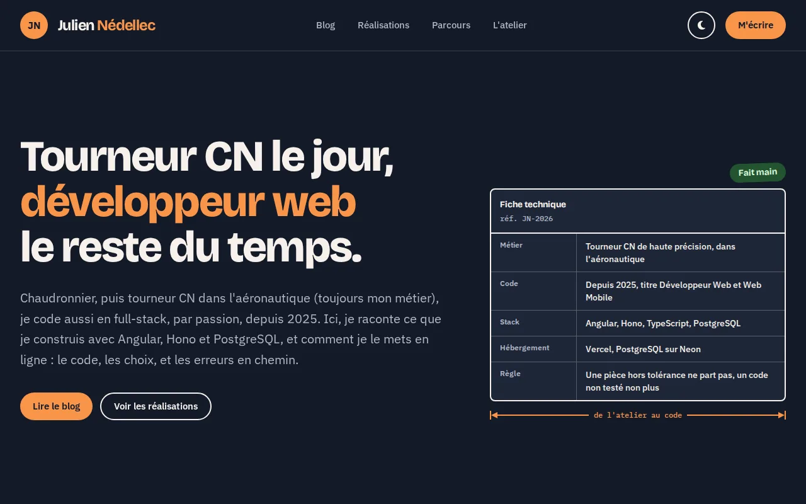
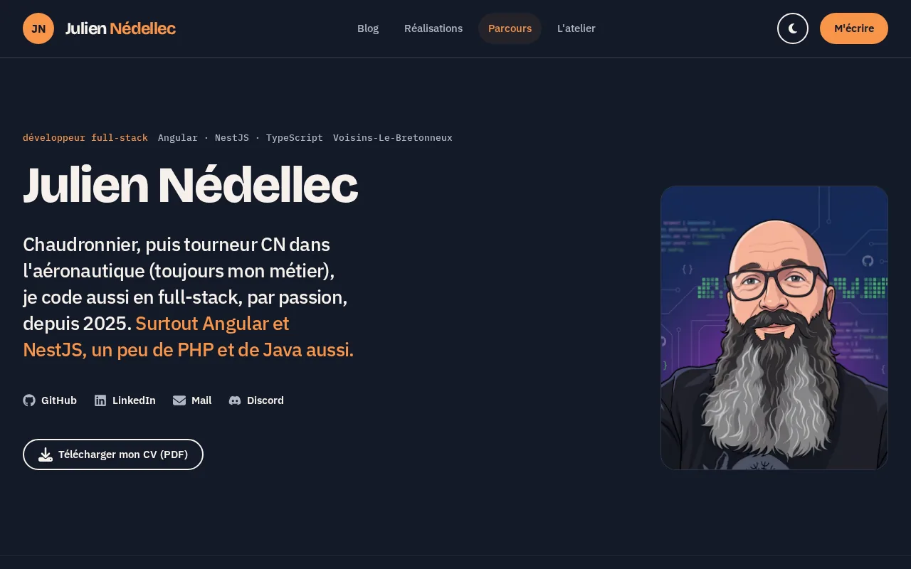
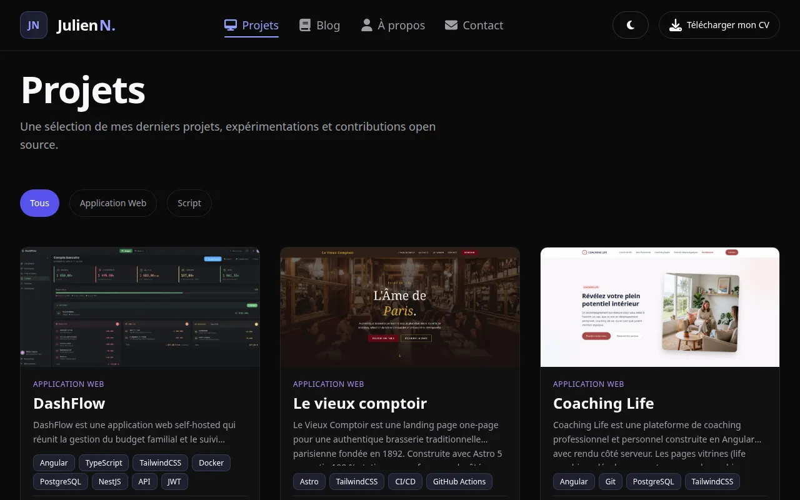
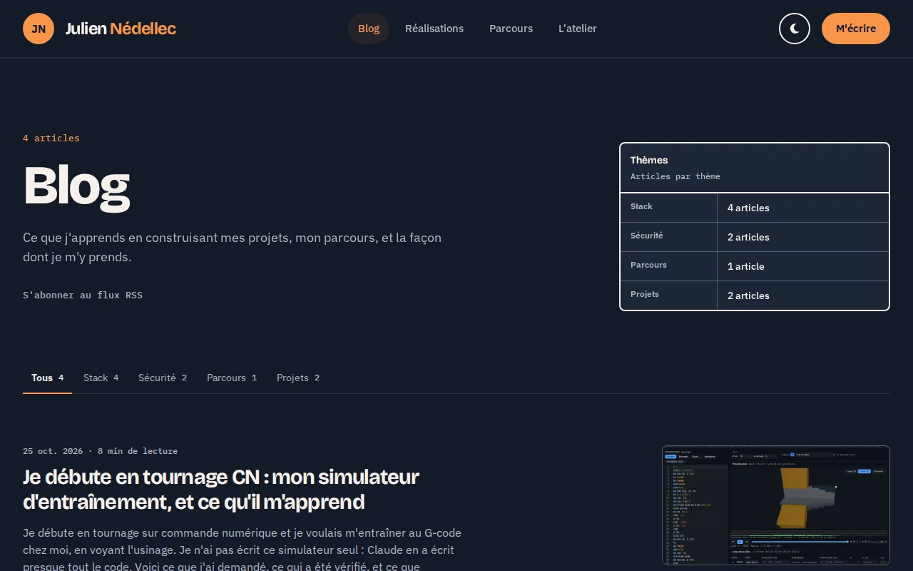

<div align="center">

# Portfolio — Julien Nédellec

### Site personnel full-stack : vitrine, blog, back-office et analytics maison

**Angular 22 zoneless · SSR + prérendu · API Hono · PostgreSQL · zéro tracker tiers**

[](https://angular.dev)
[](https://www.typescriptlang.org)
[](https://hono.dev)
[](https://www.postgresql.org)
[](https://tailwindcss.com)
[](https://github.com/j-ned/j-ned-app/actions/workflows/web-ci.yml)
[](LICENSE)

[**Site live**](https://nedellec-julien.fr) · [**API (`apps/api`)**](../api) · [**Captures**](#captures-décran) · [**Architecture**](#architecture) · [**Installation**](#installation)

</div>

---

## Sommaire

- [Le problème](#le-problème)
- [La réponse](#la-réponse)
- [Fonctionnalités](#fonctionnalités)
- [Architecture](#architecture)
- [Sécurité et vie privée](#sécurité-et-vie-privée)
- [Performance et SEO](#performance-et-seo)
- [Stack technique](#stack-technique)
- [Captures d'écran](#captures-décran)
- [Installation](#installation)
- [Qualité et livraison](#qualité-et-livraison)
- [Licence](#licence)

---

## Le problème

Un portfolio de développeur est rarement « juste une vitrine ». Il doit :

- **montrer du code de production**, pas un template sur étagère ;
- **permettre d'éditer le contenu sans redéployer**, sans passer par un CMS externe qui contredit le positionnement technique ;
- **être trouvable** : rendu serveur, données structurées, temps de chargement maîtrisé ;
- **être pilotable** : savoir qui visite quoi, sans envoyer les données à un tiers.

## La réponse

Une application full-stack, construite et exploitée comme un vrai produit :

- **Front Angular 22** zoneless, signals, rendu serveur à la requête des pages de contenu (une écriture admin est visible au rechargement, sans rebuild), prérendu des pages statiques, clean architecture en trois couches par feature.
- **Back-office** : projets, articles de blog, CV, messages de contact, analytics, sécurité du compte.
- **API Hono** ([`apps/api`](../api), même monorepo) : auth JWT + 2FA, PostgreSQL via Drizzle, stockage S3, mails, analytics.
- **Analytics maison** : aucun cookie, aucun tracker tiers, données brutes purgées au bout de 30 jours.
- **Hébergement** : serveur personnel derrière un tunnel Cloudflare (images du site et de l'API tirées de GHCR, même origine), PostgreSQL en conteneur, Cloudflare R2 ; CI GitHub Actions qui juge l'image même que la production fait tourner.

Le front vit dans `apps/web` et l'API dans `apps/api`, dans le même dépôt : servis par la même origine, `/api` relayé par nginx vers le conteneur de l'API.

---

## Fonctionnalités

### Site public

| Section      | Détails                                                                                                                                                                                                                      |
| ------------ | ---------------------------------------------------------------------------------------------------------------------------------------------------------------------------------------------------------------------------- |
| **Accueil**  | Hero, points forts, aperçu des projets mis en avant, section contact. Prérendu, hydratation incrémentale des sections sous la ligne de flottaison.                                                                           |
| **À propos** | Parcours, diplômes, stack, expertises.                                                                                                                                                                                       |
| **Projets**  | Liste filtrable par catégorie et paginée ; fiche par projet avec choix techniques, décisions d'architecture, liens démo et dépôts, navigation précédent / suivant. Toutes les fiches sont rendues côté serveur à la requête. |
| **Blog**     | Articles en Markdown assainis par DOMPurify (ADR-0002), tags colorés par catégorie et filtre par tag, commentaires Giscus, compteur de « j'aime », flux RSS.                                                                 |
| **Contact**  | Formulaire Signal Forms, validation au bord, envoi par l'API (mail à l'admin et confirmation au visiteur).                                                                                                                   |
| **CV**       | Téléchargement du PDF servi par l'API, comptabilisé dans les analytics.                                                                                                                                                      |
| **404**      | Page dédiée, servie avec un vrai statut 404 par nginx.                                                                                                                                                                       |

### Back-office (`/admin`)

| Module              | Fonction                                                                                                                                      |
| ------------------- | --------------------------------------------------------------------------------------------------------------------------------------------- |
| **Tableau de bord** | Indicateurs de visite, sessions, téléchargements du CV, clics projets.                                                                        |
| **Projets**         | CRUD, ordre, mise en avant, image convertie en AVIF ≤ 1600 px à l'upload par l'API.                                                           |
| **Blog**            | CRUD, brouillon / publié, couverture, catalogue de tags, aperçu Markdown en direct.                                                           |
| **CV**              | Remplacement du PDF.                                                                                                                          |
| **Messages**        | Boîte de réception du formulaire de contact.                                                                                                  |
| **Analytics**       | Courbes de visites, pages, provenances, navigateurs, OS, pays, projets et articles les plus vus, export CSV, exclusion de l'appareil courant. |
| **Sécurité**        | Changement de mot de passe, activation et désactivation de la 2FA TOTP avec codes de secours.                                                 |

### Transversal

- **Auth** par cookie httpOnly (JWT 7 jours) révocable, 2FA TOTP, restauration de session uniquement quand un indice local existe.
- **Thème** sombre par défaut et thème clair, tokens OKLCH dans `@theme`, Tailwind v4 CSS-first (ADR-0003).
- **View Transitions** entre routes, préchargement sélectif des routes.
- **Accessibilité** WCAG AA : cibles tactiles, `focus-visible`, régions et libellés ARIA, contrastes vérifiés sur les deux thèmes.

---

## Architecture

### Trois couches par feature

```
src/app/
├── core/          # singletons : auth store, exclusion analytics, intercepteurs, guards
├── features/
│   ├── admin/     # back-office (pages et composants)
│   ├── analytics/ # tracking et statistiques
│   ├── auth/      # login, 2FA, changement de mot de passe
│   ├── blog/      # articles, tags, commentaires, likes
│   ├── contact/   # formulaire
│   ├── cv/        # téléchargement et upload du PDF
│   ├── home/      # page d'accueil
│   ├── profile/   # page à propos
│   └── projects/  # liste, fiche, admin
├── layout/        # shell, header, footer, drawer
├── pages/         # 404
└── shared/        # UI, icônes, SEO, thème, identité du site
```

Chaque feature suit la même règle de dépendance :

```
src/app/features/<feature>/
├── domain/        # TypeScript pur : modèles (type), gateways (abstract class), use cases
├── infra/         # services Angular : gateways HTTP, adapters, données statiques
├── application/   # composants non routés
└── pages/         # pages routées, smart, un dossier par page
```

`pages → application → domain ← infra`. Le domaine ne connaît ni Angular, ni HTTP, ni les types de l'API. Le câblage des implémentations se fait dans `app.config.ts` :

```ts
providers: [
  { provide: ProjectsGateway, useClass: HttpProjectsGateway },
  { provide: BlogGateway, useClass: HttpBlogGateway },
  { provide: AnalyticsGateway, useClass: HttpAnalyticsGateway },
];
```

### Rendu

- `outputMode: server` : les pages de contenu (`/`, `/about`, `/projects`, `/projects/:slug`, `/blog`, `/blog/:slug`) sont **rendues à chaque requête** par le serveur Node (`src/server.ts`, ADR-0024) depuis l'API interne ; les pages statiques (mentions légales, confidentialité) restent **prérendues au build**, qui ne lit plus l'API. Le transfer cache évite de refaire les appels après hydratation (spec 004, origin map vers l'URL publique).
- `login`, `two-factor` et `admin/**` sont rendus côté client depuis `index.csr.html`.
- En production, l'image du site (`Dockerfile`, ADR-0038) place nginx devant le rendu Node : nginx sert `browser/` (chunks, pages prérendues, coquille CSR pour les routes client, **404 réel** pour toute URL inconnue) et ne relaie à Node que la liste fermée des routes de contenu, `sitemap.xml` et `rss.xml`. Un micro-cache d'une seconde absorbe les rafales, et la dernière copie est servie si l'API ou le rendu échoue.
- Les sections sous la ligne de flottaison de la home et de l'à-propos utilisent `@defer` avec hydratation incrémentale (ADR-0001).

### Décisions documentées

- `docs/adr/` : hydratation incrémentale des `@defer`, assainissement du Markdown, utilitaires Tailwind et `@apply`.
- `specs/` : audits d'entrée, refactors et audit global du 2026-09-10 avec plan d'action.

---

## Sécurité et vie privée

### Front

- **CSP par hachages** : après le build, `scripts/apply-csp-hashes.mjs` remplace `'unsafe-inline'` par les SHA-256 des scripts et styles inline de chaque page prérendue et écrit un manifeste ; le serveur Node applique la même fonction (`src/server/csp/harden-csp.ts`) à chaque page rendue, en n'autorisant que les scripts inline connus. La CI vérifie qu'aucun `unsafe-inline` ne subsiste.
- **En-têtes** posés par nginx sur toutes les réponses, assets compris : HSTS, `X-Frame-Options: DENY`, `frame-ancestors 'none'`, `nosniff`, `Referrer-Policy`, `Permissions-Policy`, COOP.
- **Markdown** des articles assaini par DOMPurify côté serveur et côté client avant injection.
- **Auth** : cookie httpOnly `SameSite=Lax`, logout qui révoque toutes les sessions, 2FA TOTP, formulaire de connexion limité côté API.
- `security.txt` (RFC 9116) et `robots.txt` servis à la racine.

### Analytics sans tracker

- **Aucun cookie**, aucun script tiers.
- Identifiant de session dérivé côté API de `SHA-256(ip | user-agent | jour)` : l'adresse IP n'est jamais stockée.
- Pays via `geoip-lite` en local, navigateur et OS via `ua-parser-js`, aucun appel externe.
- Robots, adresses IP privées, pages 404, propriétaire connecté et appareils exclus ne sont pas comptés.
- Provenances réduites à l'hôte (`google.com`), jamais une URL du site lui-même.
- Données brutes purgées après **30 jours**, seuls les agrégats journaliers sont conservés.

---

## Performance et SEO

### Mesures Lighthouse mobile (10 septembre 2026, production)

| Page                 | Performance | Accessibilité | Bonnes pratiques | SEO |
| -------------------- | ----------- | ------------- | ---------------- | --- |
| `/`                  | 87          | 100           | 96               | 100 |
| `/about`             | 92          | 99            | 96               | 100 |
| `/projects`          | 89          | 100           | 96               | 100 |
| `/projects/dashflow` | 95          | 96            | 96               | 100 |
| `/blog`              | 85          | 100           | 96               | 100 |
| `/blog/:slug`        | 93          | 96            | 96               | 100 |

### Ce qui les tient

- `NgOptimizedImage` sur chaque image, `priority` sur le visuel LCP de chaque page, dimensions explicites : CLS à 0.
- Images stockées en **AVIF ≤ 1600 px** par l'API à l'upload, clés dérivées du contenu et cache immuable d'un an.
- Assets hachés servis avec `Cache-Control: immutable`, gzip, préchargement sélectif des routes.
- `<title>`, meta, Open Graph et format de carte (`twitter:card`) par route ; JSON-LD `Person`, `BreadcrumbList`, `BlogPosting` et `CreativeWork` ; canonical par page.
- `sitemap.xml` et `rss.xml` rendus à la requête par le serveur Node (`src/server/feeds/`) depuis l'API : une écriture admin y apparaît au rechargement ; API en panne, le CDN sert la dernière copie.

---

## Stack technique

### Front (ce dépôt)

- **Angular 22** : zoneless, signals, `@defer`, hydratation incrémentale, `httpResource` / `rxResource`, Signal Forms.
- **Tailwind CSS v4** en CSS-first (`@theme`, `@utility`), aucun fichier de style par composant.
- **Chart.js** pour les graphiques du back-office, **marked** + **DOMPurify** pour le Markdown, **Sentry** pour les erreurs.
- **Vitest 4** + happy-dom pour les tests, **ESLint** + angular-eslint + Prettier, Husky + lint-staged.

### API ([`apps/api`](../api))

- **Hono** sur Node, **Drizzle ORM** et **PostgreSQL**, migrations versionnées.
- **Argon2id**, JWT HS256 avec `tokenVersion`, **otplib** pour la 2FA, throttling par route.
- **S3** (Cloudflare R2) derrière un proxy applicatif, **sharp** pour la conversion des images, **Resend** pour les mails, **pino** pour les logs, **Sentry**.

### Exploitation

- **Docker** : images du site et de l'API publiées sur GHCR, pile `deploy/compose.yaml` déployée par Dokploy derrière un tunnel Cloudflare, **Cloudflare R2** pour les fichiers (ADR-0038).
- **GitHub Actions** : lint, tests, build de production avec vérification du prérendu et de la CSP, image du conteneur montée devant la doublure de l'API (`ci/image-stack.sh`) pour les tests de fumée HTTP et l'audit axe.

---

## Captures d'écran

<table>
  <tr>
    <td width="50%">
      <p align="center"><b>Accueil</b></p>
      
    </td>
    <td width="50%">
      <p align="center"><b>À propos</b></p>
      
    </td>
  </tr>
  <tr>
    <td width="50%">
      <p align="center"><b>Projets</b></p>
      
    </td>
    <td width="50%">
      <p align="center"><b>Blog</b></p>
      
    </td>
  </tr>
</table>

---

## Installation

> Prérequis : Node.js 22, pnpm ≥ 10, et l'API du monorepo ([`apps/api`](../api)) lancée sur `http://localhost:3000` (`pnpm dev:api` à la racine, Postgres en conteneur).

```bash
git clone https://github.com/j-ned/j-ned-app.git
cd j-ned-app
pnpm install --frozen-lockfile
pnpm dev:web        # http://localhost:4200, /api proxifié vers :3000 (proxy.conf.cjs)
```

Le front n'a aucune variable d'environnement : en développement il parle à `/api` via le proxy du CLI, en production à `https://nedellec-julien.fr/api`, même origine que le site, relayée par nginx vers l'API (ADR-0034).

Les commentaires du blog passent par [Giscus](https://giscus.app) sur les Discussions de ce dépôt (catégorie « General », identifiants dans `src/app/shared/api/giscus-config.ts`). Le widget n'apparaît que si l'app [Giscus](https://github.com/apps/giscus) est installée sur le dépôt : sans elle, Giscus ignore le dépôt sans erreur.

### Scripts

| Commande           | Action                                                                                            |
| ------------------ | ------------------------------------------------------------------------------------------------- |
| `pnpm start`       | Serveur de développement avec proxy `/api`                                                        |
| `pnpm build`       | Build SSR ; `--configuration production` ajoute le prérendu des pages statiques et le hachage CSP |
| `pnpm test`        | Vitest (happy-dom)                                                                                |
| `pnpm lint`        | ESLint, zéro warning toléré                                                                       |
| `pnpm check`       | Prettier + lint                                                                                   |
| `pnpm icons:build` | Régénère le sprite d'icônes                                                                       |

### Image du site en local

Depuis la racine du monorepo pour le build, puis depuis `apps/web` :

```bash
docker build -f apps/web/Dockerfile -t j-ned-app-web:ci .
ci/image-stack.sh up      # image sur :3000 devant la doublure de l'API
ci/smoke.sh               # tests de fumée HTTP
ci/image-stack.sh down
```

---

## Qualité et livraison

Les gates de la CI (`.github/workflows/web-ci.yml`), rejoués en local avant chaque PR :

```bash
pnpm install --frozen-lockfile
pnpm run build --configuration production   # build SSR + prérendu + CSP
ci/verify-prerender.sh dist/angular-portfolio-app/browser dist/angular-portfolio-app/server
(cd ../.. && docker build -f apps/web/Dockerfile -t j-ned-app-web:ci .)
ci/image-stack.sh up && ci/smoke.sh; ci/image-stack.sh down
```

- Une PR par changement, squash-merge sur `master`, branche protégée par les deux jobs de CI.
- Tests à trois niveaux : domaine sans TestBed, composants avec TestBed et mocks, intégration HTTP avec `HttpTestingController`.
- Conventions détaillées dans `.claude/CLAUDE.md` et `.claude/project-profile.md`.

---

## Licence

Le **code** de ce dépôt est publié sous licence [MIT](LICENSE).

Le **contenu éditorial** (articles de blog, textes du site, CV, photos, visuels et logos) reste sous **tous droits réservés** : il n'est pas couvert par la licence MIT et ne peut être réutilisé sans autorisation.

---

<div align="center">

**Développé par [Julien Nédellec](https://nedellec-julien.fr)**

[](https://nedellec-julien.fr)
[](https://github.com/j-ned)
[](https://www.linkedin.com/in/julien-nedellec/)

</div>
